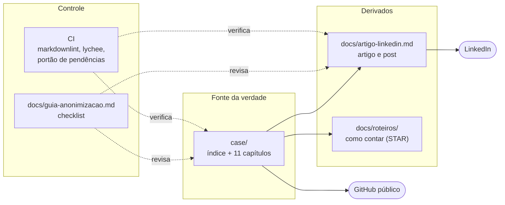

# modernization-case


Estudo de caso, anonimizado, de modernização de um sistema legado: estratégia, decisões, migração e resultados.

> **Status:** esqueleto. A estrutura está pronta e o conteúdo real está sendo preenchido. Trechos marcados como "exemplo ilustrativo, substituir" são inventados e **não** descrevem fatos.

## Por que este repositório existe

Modernizar um legado sem parar a operação é um dos problemas mais comuns e menos bem contados da engenharia. Os relatos costumam ser genéricos ("migramos para microsserviços") ou sem números. Este repositório conta **um** caso real, com:

- as restrições que tornaram o problema difícil;
- a estratégia escolhida e as que foram descartadas;
- as decisões técnicas em formato de mini-ADR, com o preço de cada uma;
- a migração de dados, os riscos e o que deu errado;
- métricas de antes e depois com período, fonte e método;
- o que eu faria diferente hoje.

Os nomes de empresa, clientes, pessoas e sistemas foram removidos, e os números sensíveis foram normalizados, seguindo o [guia de anonimização](docs/guia-anonimizacao.md).

**Comece por aqui:** [case/README.md](case/README.md).

## Estrutura



| Caminho | Conteúdo |
| --- | --- |
| [`case/`](case/README.md) | O estudo de caso: resumo executivo e 11 capítulos |
| [`docs/guia-anonimizacao.md`](docs/guia-anonimizacao.md) | Como anonimizar, com checklist de publicação |
| [`docs/artigo-linkedin.md`](docs/artigo-linkedin.md) | Esqueleto do artigo e do post de divulgação |
| [`docs/roteiros/como-contar-o-case.md`](docs/roteiros/como-contar-o-case.md) | Como apresentar o case em entrevista, no método STAR |
| [`docs/design-doc.md`](docs/design-doc.md) | Como o repositório funciona e por quê |
| [`docs/adr/`](docs/adr/) | Decisões sobre o repositório (formato, publicação, CI) |
| [`scripts/check-placeholders.sh`](scripts/check-placeholders.sh) | Lista ou bloqueia pendências no conteúdo publicável |

## Como preencher

Cada capítulo tem a mesma estrutura: objetivo, perguntas-guia, campos marcados com comentários HTML `PREENCHER` (invisíveis na renderização) e um exemplo ilustrativo com o nível de detalhe esperado.

1. Crie uma branch por capítulo: `git switch -c docs/case-01-contexto`.
2. Responda às perguntas-guia com os fatos reais. Rascunhos com nomes reais ficam fora do Git, em `rascunhos/` ou em arquivos `*.local.md` (ambos no `.gitignore`).
3. Substitua cada campo `PREENCHER` pelo texto final e **apague o exemplo ilustrativo** da seção.
4. Revise com o [guia de anonimização](docs/guia-anonimizacao.md) e rode a varredura local de termos proibidos.
5. Rode as verificações locais (abaixo) e abra um PR. O template traz o checklist de anonimização.
6. Depois do case, escreva o artigo a partir de [`docs/artigo-linkedin.md`](docs/artigo-linkedin.md) e treine com o [roteiro](docs/roteiros/como-contar-o-case.md).

Ordem sugerida: 1, 2, 3, 6, 4, 5, 7, 8, 9, 10, 11 e, por último, o resumo executivo em `case/README.md`.

## Como verificar localmente

Pré-requisitos: Node.js 20 ou mais recente e Docker.

```bash
# Lint de Markdown (mesma versão do CI)
npx --yes markdownlint-cli2@0.24.2

# Links e âncoras internos, offline (mesma imagem do CI)
docker run --rm -v "$PWD":/input -w /input lycheeverse/lychee:0.24.2 \
  --config lychee.toml --offline '**/*.md'

# Progresso do preenchimento (lista as pendências, não falha)
./scripts/check-placeholders.sh --report

# Portão de publicação (falha se houver pendências)
./scripts/check-placeholders.sh
```

Não há código nem testes automatizados de comportamento: o "teste" deste repositório é o lint, a verificação de links e o portão de pendências.

## CI

O workflow [`ci.yml`](.github/workflows/ci.yml) roda em PRs e em push na `main`:

| Job | O que faz | Quando falha |
| --- | --- | --- |
| Lint de Markdown | markdownlint-cli2 com [`.markdownlint-cli2.jsonc`](.markdownlint-cli2.jsonc) | Markdown fora do padrão |
| Links internos | lychee `--offline` com âncoras ([`lychee.toml`](lychee.toml)) | Link ou âncora quebrada entre arquivos |
| Lint e teste dos scripts | shellcheck e relatório de pendências | Erro de shell script |
| Portão de pendências (main) | `scripts/check-placeholders.sh` | Marcador `PREENCHER` ou exemplo ilustrativo no conteúdo publicável |

O **portão de pendências está desligado por padrão**, porque o case ainda está sendo preenchido. Ele só roda quando a variável de repositório `ENFORCE_PLACEHOLDER_GATE` vale `true`. Para ligar, quando o case estiver completo: *Settings > Secrets and variables > Actions > Variables > New repository variable*, nome `ENFORCE_PLACEHOLDER_GATE`, valor `true`. Detalhes no [ADR 0003](docs/adr/0003-portao-de-pendencias-desligado-por-padrao.md).

## Decisões

| ADR | Decisão |
| --- | --- |
| [0001](docs/adr/0001-case-em-markdown-por-capitulos.md) | Case em Markdown, um arquivo por capítulo, mini-ADRs da modernização dentro do capítulo 4 |
| [0002](docs/adr/0002-github-como-fonte-e-linkedin-como-vitrine.md) | GitHub como fonte da verdade, LinkedIn como vitrine derivada |
| [0003](docs/adr/0003-portao-de-pendencias-desligado-por-padrao.md) | Portão de pendências no CI, desligado até o case ficar pronto |

As decisões técnicas **da modernização** estão em [case/04-decisoes.md](case/04-decisoes.md).

## Trade-offs

- **Markdown puro em vez de site estático:** zero build e renderização nativa no GitHub, em troca de navegação mais simples (links entre capítulos em vez de menu lateral).
- **Artigo escrito à parte em vez de gerado:** dá retrabalho, mas o formato de um artigo é diferente do de um case técnico. A regra é que o artigo só usa fatos que estão no repositório.
- **Exemplos ilustrativos no esqueleto:** mostram o nível de detalhe esperado, mas criam o risco de publicar ficção como fato. O risco é coberto pelo portão de pendências e pelo checklist do PR.
- **Varredura de termos proibidos fora do CI:** a lista de nomes reais não pode ser versionada, então a checagem de nomes é local e manual; o CI só verifica pendências.

## Próximos passos

- [ ] Preencher os 11 capítulos com fatos reais e apagar os exemplos ilustrativos.
- [ ] Escrever o resumo executivo e a ficha técnica em `case/README.md`.
- [ ] Revisão completa com o guia de anonimização e teste do estranho.
- [ ] Ligar o portão de pendências (`ENFORCE_PLACEHOLDER_GATE=true`).
- [ ] Tornar o repositório público e publicar o artigo no LinkedIn.
- [ ] Treinar as três versões do roteiro de entrevista.
- [ ] Avaliar uma versão em inglês do case, se fizer sentido para vagas internacionais.

## Licença

[MIT](LICENSE).
