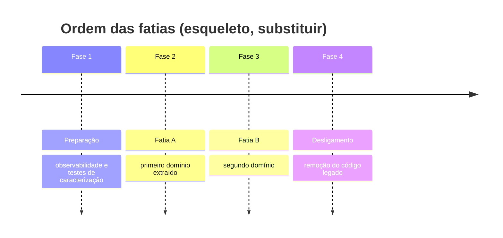

# 3. Estratégia de modernização

**Objetivo:** o leitor entende qual foi o caminho escolhido, que alternativas foram descartadas e em que ordem as partes do sistema foram atacadas.

## Perguntas-guia

### Escolha da estratégia

- Quais estratégias foram consideradas? Por exemplo:
  - **reescrita total (big bang);**
  - **strangler fig:** um roteador ou gateway na frente, desviando rota a rota para o novo;
  - **branch by abstraction:** uma abstração dentro do código legado, com a implementação nova atrás dela e troca por flag;
  - **monólito modular primeiro:** separar módulos e fronteiras dentro do próprio monólito antes de extrair serviços;
  - **parallel run:** novo e antigo processando a mesma entrada e comparando as saídas;
  - **lift and shift / replatform:** mudar a infraestrutura sem mudar o código.
- Por que a escolhida venceu, dadas as restrições do [capítulo 2](02-restricoes.md)?
- Foi uma estratégia só ou uma combinação? Em que parte do sistema cada uma foi usada?

### Ordem e fatiamento

- Como as fronteiras foram definidas (bounded contexts, módulos por equipe, por volatilidade, por risco)?
- Qual foi a primeira fatia e por quê? Foi escolhida por baixo risco, alto valor ou para aprender?
- Como o progresso era medido (rotas migradas, percentual de tráfego, tabelas sem escrita no legado)?
- Quando o legado seria desligado? Ele foi desligado?

### Governança

- Como as decisões eram registradas e comunicadas?
- Como a modernização convivia com o roadmap de produto?

## Conteúdo

### Estratégias consideradas

<!-- PREENCHER: de 2 a 4 estratégias consideradas, com um motivo curto para aceitar ou descartar cada uma. -->

### Estratégia escolhida

<!-- PREENCHER: a estratégia ou combinação, em 1 ou 2 parágrafos, ligando cada escolha a uma restrição. -->

### Fatiamento e ordem

<!-- PREENCHER: lista ordenada das fatias (domínios, módulos ou rotas), com o critério de ordem. Use nomes genéricos de domínio: "pedidos", "faturamento", "notificações". -->

### Critério de "pronto" por fatia

<!-- PREENCHER: o que precisava ser verdade para considerar uma fatia migrada. Ex.: 100% do tráfego no novo por X dias, legado sem escrita na tabela, alarmes configurados. -->

## Exemplo ilustrativo

> **Exemplo ilustrativo, substituir.** Descartamos a reescrita total porque o roadmap não podia parar por um ano e ninguém conhecia todas as regras de faturamento. Escolhemos strangler fig na borda, com um gateway desviando rotas HTTP para os serviços novos, e branch by abstraction no núcleo de cálculo de frete, que era chamado por dentro do monólito e não tinha rota própria. A primeira fatia foi notificações: baixo risco, pouco acoplamento e um bom terreno para validar o pipeline e a observabilidade. Uma fatia só era considerada pronta depois de 14 dias com 100% do tráfego no serviço novo e nenhuma escrita do legado nas tabelas dela.

---

[← Restrições](02-restricoes.md) · [Índice](README.md) · [Decisões →](04-decisoes.md)
