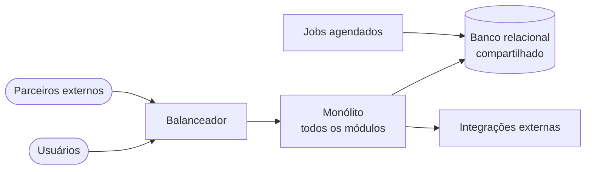
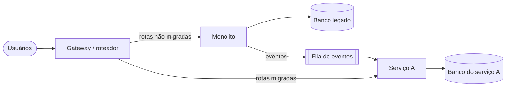
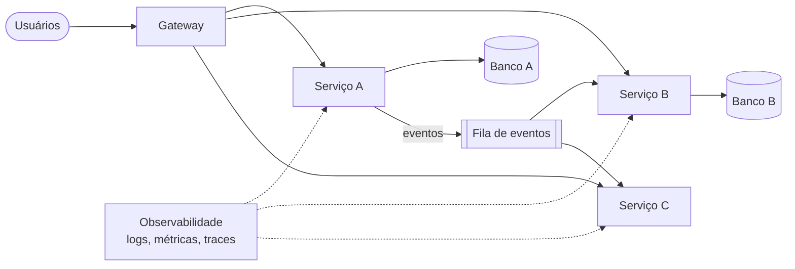

# 5. Arquitetura antes e depois

**Objetivo:** o leitor enxerga, em dois diagramas, o que mudou estruturalmente. Um terceiro diagrama mostra o estado de transição, que é onde a maior parte do trabalho real acontece.

## Perguntas-guia

- Quais eram os principais componentes do legado e como eles se falavam?
- Onde estavam os pontos de acoplamento mais caros (banco compartilhado, chamadas internas, jobs agendados, arquivos em disco)?
- Como era a arquitetura durante a transição? Quanto tempo o sistema ficou nesse estado híbrido?
- Como ficou a arquitetura no fim? O legado foi desligado ou sobrou um núcleo?
- Que componentes de infraestrutura entraram (gateway, mensageria, cache, observabilidade)?
- Quais fronteiras ficaram diferentes do que foi planejado no início?

## Regras para os diagramas

- Use **rótulos genéricos**: "Monólito", "Serviço de pedidos", "Fila de eventos", "Banco relacional". Nada de nomes internos de sistemas, de produtos ou de clientes.
- Tecnologias de mercado podem aparecer (PHP, Go, MySQL, RabbitMQ), desde que não identifiquem a empresa em conjunto com outros detalhes. Veja o [guia de anonimização](../docs/guia-anonimizacao.md).
- Diagramas abaixo são **esqueletos**: ajuste nós e setas aos fatos reais.

## Antes

<!-- PREENCHER: ajuste o diagrama ao legado real e escreva 1 parágrafo explicando os pontos de dor que ele mostra. -->

## Transição

<!-- PREENCHER: mostre o estado híbrido: o que já tinha saído, por onde o tráfego passava e como os dados eram sincronizados. -->

## Depois

<!-- PREENCHER: ajuste ao estado final real. Se o legado não foi totalmente desligado, mostre o que sobrou. -->

## O que mudou

| Aspecto | Antes | Depois |
| --- | --- | --- |
| Unidade de deploy | <!-- PREENCHER --> | <!-- PREENCHER --> |
| Dados | <!-- PREENCHER --> | <!-- PREENCHER --> |
| Comunicação | <!-- PREENCHER --> | <!-- PREENCHER --> |
| Observabilidade | <!-- PREENCHER --> | <!-- PREENCHER --> |
| Infraestrutura | <!-- PREENCHER --> | <!-- PREENCHER --> |

## Exemplo ilustrativo

> **Exemplo ilustrativo, substituir.** Antes, um único processo PHP servia a interface da operação, a API dos parceiros e os jobs de faturamento, todos lendo e escrevendo nas mesmas tabelas. O ponto mais caro era o job noturno de faturamento, que travava tabelas usadas pela API. Na transição, que durou sete meses, um gateway passou a desviar a API de parceiros para dois serviços novos, e o monólito publicava eventos de pedido numa fila. No fim, o monólito ficou só com o back-office interno, de baixo tráfego, e cada serviço novo passou a ter banco próprio.
