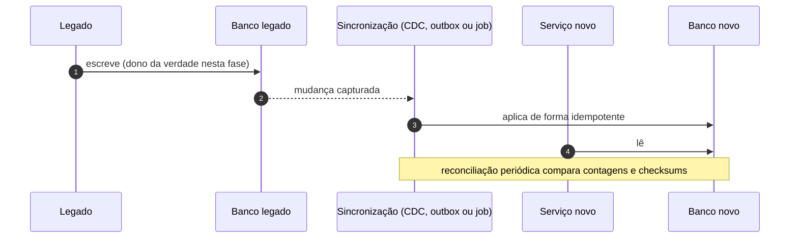

# 6. Migração de dados

**Objetivo:** o leitor entende como os dados saíram do legado sem perda e sem parada, e como a consistência foi verificada. Em modernizações, esta costuma ser a parte mais arriscada e a menos contada.

## Perguntas-guia

### Estratégia

- Os dados foram divididos por serviço? Houve período de banco compartilhado?
- Qual técnica foi usada para sincronizar legado e novo?
  - carga inicial (backfill) seguida de sincronização incremental;
  - CDC (captura de mudanças a partir do log do banco);
  - eventos de domínio com outbox;
  - dupla escrita (e como os riscos dela foram controlados);
  - leitura do novo com fallback para o legado.
- Quem era o dono da verdade em cada fase? Como e quando o dono mudou?

### Execução

- Qual o volume (ordem de grandeza) e quanto tempo levou a carga inicial?
- Houve transformação de esquema (normalização, mudança de chave, separação de colunas)?
- Como foram tratados dados sujos ou inconsistentes encontrados no caminho?
- Como era o corte (cutover) de cada fatia? Havia janela? Qual era o plano de volta?

### Verificação

- Como a consistência foi comprovada (contagens, checksums, reconciliação por amostragem, comparação de saídas)?
- Com que frequência a reconciliação rodava e quem olhava o resultado?
- Houve divergência relevante? Como foi descoberta e corrigida?

## Conteúdo

### Estratégia por fase

<!-- PREENCHER: descreva cada fase e quem era o dono da verdade nela. A tabela abaixo é um ponto de partida. -->

| Fase | Escrita em | Leitura de | Sincronização | Dono da verdade |
| --- | --- | --- | --- | --- |
| <!-- PREENCHER --> | <!-- PREENCHER --> | <!-- PREENCHER --> | <!-- PREENCHER --> | <!-- PREENCHER --> |

### Corte e plano de volta

<!-- PREENCHER: como foi o corte, quanto tempo durou, o que disparava o rollback e se ele chegou a ser usado. -->

### Verificação de consistência

<!-- PREENCHER: o mecanismo de reconciliação, a frequência e a divergência mais relevante encontrada. -->

## Exemplo ilustrativo

> **Exemplo ilustrativo, substituir.** Para pedidos, fizemos uma carga inicial de cerca de 30 milhões de linhas em lotes noturnos ao longo de uma semana, seguida de sincronização por eventos com outbox. Por um mês o legado seguiu como dono da verdade e o serviço novo só lia; um job diário comparava contagens por dia e checksums de 1% dos pedidos. A reconciliação achou pedidos com fuso horário gravado errado desde a origem, que corrigimos na transformação e não no legado. O corte de escrita aconteceu numa janela de 10 minutos, com rollback por flag testado duas vezes em homologação e nunca usado em produção.
