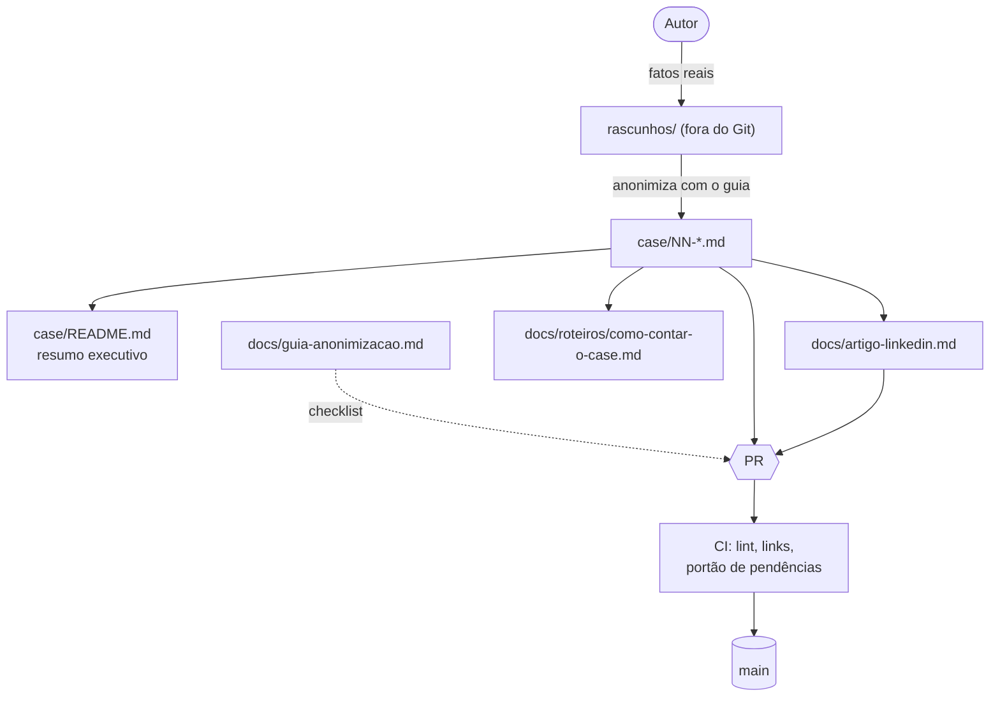
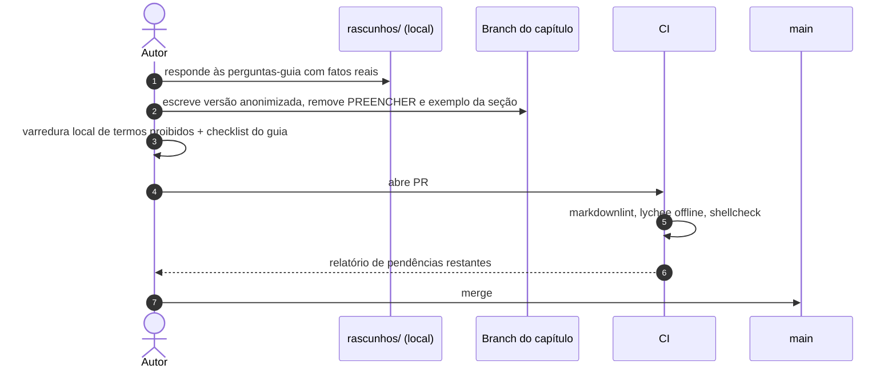
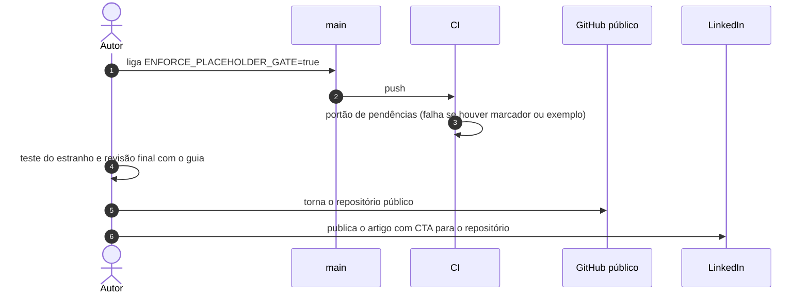

# Design doc: repositório do estudo de caso

Este documento descreve como o repositório está organizado e por quê. O conteúdo técnico da modernização está em [`case/`](../case/README.md); aqui está o "sistema" que produz, revisa e publica esse conteúdo.

## Contexto

O autor quer mostrar, a recrutadores e entrevistadores, uma modernização de legado que conduziu de verdade. A experiência envolve uma empresa real, com clientes, números e pessoas que não podem aparecer. O conteúdo vai ser escrito aos poucos e publicado em dois canais: GitHub e LinkedIn.

## Objetivos

- Dar ao autor uma estrutura que leve a um case completo: cada capítulo diz o que responder e com que nível de detalhe.
- Impedir, por processo e por CI, que dois erros cheguem à publicação: **dados identificáveis** e **exemplos inventados lidos como fatos**.
- Manter o case, o artigo e o roteiro de entrevista coerentes entre si.
- Ser legível no GitHub sem build.

## Não objetivos

- Escrever o case pelo autor. O esqueleto não traz fatos.
- Detectar nomes reais automaticamente no CI. A lista de nomes não pode ser versionada (ver [Segurança](#segurança)).
- Gerar o artigo a partir dos capítulos.
- Hospedar um site.

## Arquitetura do conteúdo

### Modelo do capítulo

Todo capítulo tem as mesmas partes, para que o autor saiba o que fazer e o agente saiba o que não tocar:

| Parte | Função | Fica na versão publicada? |
| --- | --- | --- |
| Título e objetivo | O que o leitor precisa entender | Sim |
| Perguntas-guia | O que o autor responde | Opcional (pode ser removida) |
| Conteúdo | Texto final, tabelas e diagramas | Sim |
| Campos `PREENCHER` | Marcam o que falta | Não |
| Exemplo ilustrativo | Mostra o nível de detalhe | Não |
| Navegação | Links para anterior, índice e próximo | Sim |

### Marcadores

| Marcador | Forma | Detectado por |
| --- | --- | --- |
| Pendência | Comentário HTML que começa com `PREENCHER` | `scripts/check-placeholders.sh` |
| Exemplo inventado | Citação que começa com o rótulo "exemplo ilustrativo, substituir" | `scripts/check-placeholders.sh` |

Comentários HTML não aparecem na renderização do GitHub. Por isso o esqueleto pode ser publicado sem mostrar marcadores ao leitor, mas os exemplos ilustrativos aparecem, e é por isso que eles têm rótulo visível.

## Fluxos principais

### Preencher um capítulo

### Publicar

## Falhas e como são tratadas

| Falha | Consequência | Tratamento |
| --- | --- | --- |
| Exemplo ilustrativo publicado como fato | Afirmação falsa sobre a experiência do autor | Rótulo visível, portão de pendências, item no checklist do PR |
| Nome real ou detalhe identificável publicado | Quebra de confidencialidade | Guia, varredura local de termos, teste do estranho, checklist do PR |
| Nome real commitado por engano | Fica no histórico mesmo após apagar | Rascunhos no `.gitignore`; varredura do histórico antes do primeiro push público; reescrever histórico se preciso |
| Número divergente entre case e artigo | Perda de credibilidade | Repositório como fonte da verdade ([ADR 0002](adr/0002-github-como-fonte-e-linkedin-como-vitrine.md)); checklist do artigo |
| Link ou âncora quebrada após renomear seção | Navegação quebrada | lychee offline com verificação de âncoras no CI |

## Segurança

- A lista de termos proibidos (nomes reais) **nunca** entra no repositório: ela mesma seria o vazamento. Fica em `~/.config/modernization-case/termos-proibidos.txt`, na máquina do autor.
- `rascunhos/`, `*.local.md`, `.env` e `config.local.yaml` estão no `.gitignore`.
- O CI usa `permissions: contents: read` e não acessa a internet para checar links (`--offline`).
- Issue forms pedem para não repetir dados sensíveis, mesmo ao reportar um vazamento.

## Observabilidade

Não se aplica: não há serviço em execução. O equivalente é o relatório de pendências (`./scripts/check-placeholders.sh --report`), que roda em todo PR e mostra quantos marcadores e exemplos faltam, por arquivo.

## Alternativas consideradas

- **Site estático com MkDocs:** navegação melhor, mas exige build e deploy. Ver [ADR 0001](adr/0001-case-em-markdown-por-capitulos.md).
- **Varredura de nomes no CI com a lista em segredo do GitHub:** possível, mas os nomes apareceriam em logs de falha e a lista ficaria num lugar a mais. Descartada.
- **Esqueleto sem exemplos:** eliminaria o risco de publicar ficção, mas deixaria o autor sem referência de profundidade. Descartada em favor de exemplos rotulados e de um portão.
- **Portão sempre ligado:** ver [ADR 0003](adr/0003-portao-de-pendencias-desligado-por-padrao.md).

## Plano de evolução

1. Preencher os capítulos, um PR por capítulo.
2. Ligar o portão de pendências e tornar o repositório público.
3. Publicar o artigo e o post de divulgação.
4. Se o case render uma série de posts, avaliar um site estático e uma versão em inglês.
